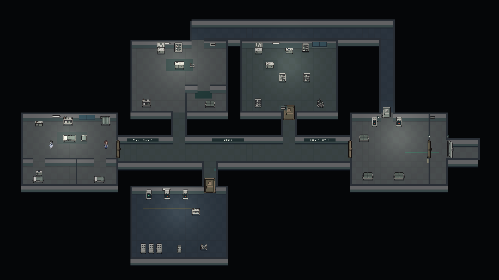

# 병동 평면 재구성

기존 다섯 개 방의 가로 직렬 연결을 중앙 복도와 양쪽 분기 구조로 바꿨다. 원래 루시 및 직전 PR의 픽셀 에셋을 유지한다.

```text
             직원 전용 연결 통로 ───────────────┐
             │           관찰창                │
       간호실·휴게실      기록 보관실            │
             │                │                A
병실 ────────┴────── 중앙 복도 ┴───────── 출구 로비 ─ B ─ C
                    │
                 전력 설비실
```

- 병실은 침상 구역과 공용 입구를 구획하고, 간호실의 직원 휴게실을 벽으로 분리한다.
- 방을 통과해야 다음 방에 갈 수 있던 구성을 없앤다. 각 부서는 공용 복도로 나와 접근하며, 직원 전용 통로는 북쪽에서 출구 로비까지 이어진다.
- 설비실 출입구는 배전반을 피해 동쪽으로 치우치게 배치한다. 길 안내는 복도 벽에 부착한다.
- 캐릭터와 가구는 월드 좌표의 깊이를 공유하며 모든 방에서 바닥 위에 그려진다.
- 카메라는 두 축을 따라 이동한다. 순회자·서연은 실제 벽/가구 충돌을 사용하는 반 단위 경로를 따라 걸으며, 상태 변경으로 위치를 이동시키지 않는다.
- 진행 잠금은 x 좌표의 임계값이 아니라 각 출입구의 직사각형으로 검사한다. 수평 출입문에도 같은 규칙을 적용한다.
- 저장 버전 2에 서연의 경로 단계를 저장한다. 기존 버전 1 저장은 사건·소지품을 유지한 채 방별 좌표를 새 배치로 옮긴다.

## 검증

- 2026-10-20 Unity Editor에서 가상 키보드로 함께 탈출/먼저 탈출 모두 통과. 실제 B/C문 통과, 붙잡힘 후 체크포인트 복구, 엔딩 일시정지/재개 및 R 재시작 확인.
- 각 진행 단계의 잠긴 목적지와 직원 통로 우회 차단 확인. 북쪽 방을 포함해 캐릭터가 바닥 위에 표시되는지 자동 검사 및 캡처 확인.
- 프로젝트 검사 87개 통과. 최종 Windows 빌드 오류 0, 경고 0.
- 전체 경로 검증은 Editor에서 수행했으며 독립 실행 파일에서 전체 경로를 다시 플레이한 것은 아님. 기존 v1 저장 변환은 구현했지만 별도 자동 재현 검증에는 포함하지 않음.

## 실제 렌더링



위 이미지는 게임 카메라로 실제 씬을 내려다본 검토용 캡처다. 플레이 카메라는 루시를 두 축으로 따라간다.
